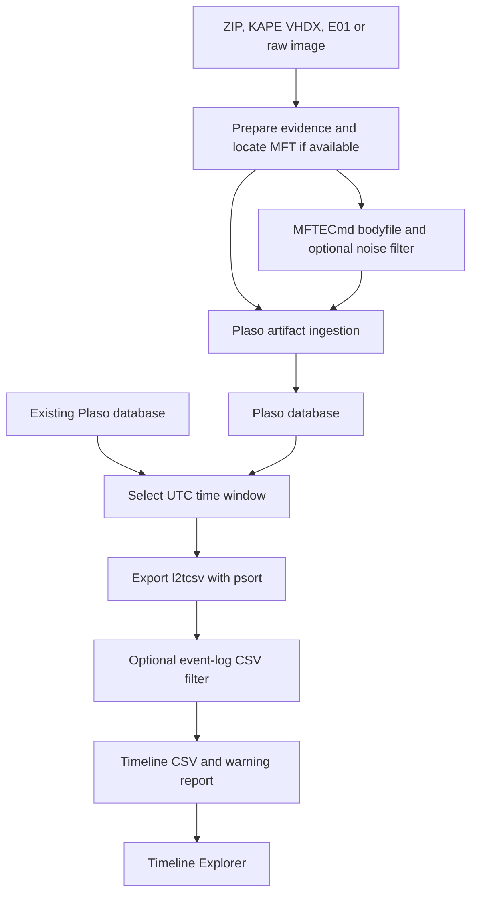

# Supertimeline creator

<p align="center">
  
</p>

Supertimeline Creator automates the DFIR workflow of turning triage collections
and disk images into a supertimeline CSV that can be opened in
[Timeline Explorer](https://ericzimmerman.github.io/) for
investigation. It supports KAPE and Velociraptor triage ZIPs, KAPE VHDX
containers, and E01 or raw disk images. Existing Plaso databases can also be
re-exported with a different time window without ingesting the evidence again.

The Docker-based pipeline prepares the evidence, extracts and filters MFT
data with MFTECmd where available, ingests artifacts with Plaso, and exports
and filters an `l2tcsv` timeline. For each image it produces a separate CSV,
Plaso database and warning report; an existing Plaso input produces a new CSV
and report. The default export window and filters can be adjusted; review the
warning report and [known limitations](KNOWN_ISSUES.md) before drawing conclusions.

The image builds a Linux MFTECmd executable from .NET 10 source and combines it
with Plaso and Sleuth Kit's `mactime` utility. During the build, APT selects
the ICU runtime package required by the Linux base image, and MFTECmd is
checked for successful startup.

This project was created with AI assistance. Review the code, test it
against your own collections, and check the warning reports before relying on
the results for an investigation.

The Python files have separate jobs: `run.py` is the host-side Docker Compose
launcher, `runner.py` processes the archives inside the Linux container, and
`patch_plaso.py` applies a guarded Plaso compatibility fix during image build.
The launcher needs only Python's standard library and does not require Plaso or
Linux-specific tools on the host.

## Workflow



For new evidence, the saved Plaso database is also placed in the output folder.
Re-exporting reads the existing database and produces a new CSV and report.

## Requirements

- Docker Engine with the Compose plugin, or Docker Desktop using Linux
  containers, and Python 3.8 or later on Windows or Linux. The supplied
  MFTECmd build targets `linux-x64`; non-x86-64 hosts require compatible
  emulation and were not tested.
- Internet access for the image build. Each launcher run requests current
  Dockerfile base images; the build fails if they cannot be fetched. Docker
  Desktop must have sufficient CPU, memory, and disk allocated in its settings.
- Sufficient disk space in **both** Docker's Linux filesystem and the output
  folder. ZIP contents, intermediate bodyfiles, and the working Plaso database
  live inside the container. Completed CSVs and databases are copied to the
  output folder. Large collections can need many gigabytes and substantial
  processing time.

## Usage

1. Start Docker and create an input and an output directory.
2. Put the images to process directly in the input directory. Supported files
   are KAPE or Velociraptor `.zip`, KAPE `.vhdx`, E01 `.E01`, and raw `.dd`,
   `.img` or `.raw`, and existing `.plaso` databases. The input directory is
   **not** scanned recursively. Alternatively, pass a single `.plaso` file
   directly as `--input`.
   For segmented E01 images, keep the first `.E01` and all subsequent segments
   together; they are processed as one image.
3. From the project directory, run the command for your host below, replacing
   the paths and timezone. Both directories must already exist.
4. Review the CSV and its warning report in the output directory. A completed
   run can still have parser warnings or coverage limitations.

**The default CSV covers the last three calendar months, applies MFT and
event-log noise filters, and deduplicates matching rows.** See [Default filtering](#default-filtering)
before choosing the settings for your investigation.

Linux:

```sh
python3 run.py --input /path/to/input --output /path/to/output --timezone Europe/Zurich
```

Windows PowerShell, with Docker Desktop using Linux containers:

```powershell
py -3 .\run.py --input 'C:\Cases\Input' --output 'C:\Cases\Output' --timezone Europe/Zurich
```

On Windows, use local directories for both input and output; UNC paths such as
`\\server\share\folder` and mapped network drives are not supported by this
launcher. Docker Desktop has reported problems with bind mounts from [UNC
paths](https://github.com/docker/for-win/issues/13172) and [mapped SMB
shares](https://github.com/docker/for-win/issues/14271). Store the input files
locally before processing and write results to a local output directory.

The input directory is mounted read-only. Different input types can be mixed;
images in one run share the same input timezone, and all inputs share the
export window and options. Run separate commands when image source systems
have different timezones. Use an
IANA timezone name; if the source timezone is unknown, `UTC` is an assumption,
not proof of the source setting.

To export a new window from an existing Plaso file, for example:

```sh
python3 run.py --input /path/to/output/plaso/case.plaso --output /path/to/output --timewindow 2023-01-01..2023-01-27
```

On Windows, use `py -3 .\run.py` and local Windows paths in the same way.
The output is `case-supertimeline-2023-01-01_to_2023-01-27.csv`, with a
correspondingly named warning report. Different windows can be exported into
the same directory; existing files are not overwritten. `--all-time` uses the
suffix `-all-time`. The default three-month window uses UTC timestamps in the
output name. Use a completed database that is no longer being written. The
input database is read-only and is not copied to the output.
For a single file, the launcher mounts its parent directory read-only and
selects only that file. A folder may contain several Plaso files or a mix of
Plaso files and other supported inputs.

A timezone is not needed for Plaso-only input: its timestamps were interpreted
during ingestion and cannot be changed by re-exporting. The CSV event-log
filter and EVTX creation-time selection still apply; `--no-filter` disables the
CSV filter. MFT noise filtering was already applied when the database was
created, so `--no-filter` cannot recover events excluded at ingestion. The
new warning report includes warnings recorded in the database, but cannot
reconstruct separate processing logs or reports from the original run.

### Default filtering

The defaults reduce the volume of records when reviewing multiple triage
collections. A generated CSV is a selected investigative view of the parsed
data. The following rules apply unless changed as described below:

| Rule | What is excluded by default | Where it applies | How to change it |
| --- | --- | --- | --- |
| Time window | Events outside the rolling three calendar months ending at processing time, plus undated events. | CSV export only; parsed dates remain in the saved database. | Set `--timewindow START..END`, or use `--all-time` to include all dates and undated events. |
| MFT attribute filter | Bodyfile lines marked `($FILE_NAME)`. | Before ingestion: excluded from both the database and CSV. | Edit [timeline_noise.txt](timeline_noise.txt), or use `--no-filter`. |
| MFT path noise | Bodyfile lines matching the path/name patterns listed below. | Before ingestion: excluded from both the database and CSV. Other artifact parsers are unaffected by this rule. | Edit [timeline_noise.txt](timeline_noise.txt), or use `--no-filter`. |
| Event-log selection | WinEVTX rows that do not match **both** a configured log pattern and an allowed Event ID. This step retains all non-WinEVTX rows it receives. | CSV only; parsed events remain in the database. | Edit [event_logs.txt](event_logs.txt) and [event_ids.txt](event_ids.txt), or use `--no-filter`. |
| CSV deduplication | After event-log filtering, all but the first row with the same displayed date, time, timezone and long description (`desc`). Source path and other fields are not compared. | CSV only; stored events remain in the database. | Use `--include-duplicates` to disable the CSV pass. |
| EVTX timestamp selection | EVTX event timestamps whose description is not `Creation Time`. This describes the event record, not the `.evtx` file's filesystem creation time. | CSV export only, including with `--no-filter` and `--all-time`. | Fixed pipeline behavior; no launcher switch disables it. |

The default MFT path/name patterns match `WinSxS`, `assembly`, `odlsent`, `.odl`,
`Cache_Data`, `Code Cache`, `Service Worker`, `Packages`,
`windowsapps/microsoft`, `Program Files/WindowsApps`, `SystemApps`,
`Microsoft Office` and `Acrobat Reader DC`. The linked configuration contains
the exact GNU grep patterns and directory boundaries; matching ignores case
and normalizes path separators.

The event-log list contains 12 patterns: Application, System, Security,
PowerShell Operational, WMI-Activity Operational, RemoteDesktopServices-RdpCoreTS
Operational, TaskScheduler Operational, TerminalServices-LocalSessionManager
Operational, TerminalServices-RemoteConnectionManager Operational,
TerminalServices-RDPClient Operational, Windows Defender Operational and Sysmon
Operational. **Only the 108 IDs in `event_ids.txt` are eligible**, even for these
logs. For example, Sysmon network connections (ID 3) and registry value sets
(ID 13) are intentionally excluded. Users can extend the lists to include
them. Log patterns currently match the whole CSV record; see
[Event-log CSV filter](#event-log-csv-filter) for matching details.

To include all dates, disable both configurable noise filters, and disable the
CSV deduplication pass:

```sh
python3 run.py --input /path/to/input --output /path/to/output --timezone Europe/Zurich --all-time --no-filter --include-duplicates
```

The fixed EVTX timestamp selection still applies, and Plaso may group some
events before CSV filtering. `--all-time` alone does not disable noise filters;
`--no-filter` alone does not remove the time window or disable deduplication.
When re-exporting an existing database, previously excluded MFT records require
re-ingestion from the original evidence. Editing the filter files takes effect
on the next launcher build.

The previous opt-in `--deduplicate-vss` option has been removed; CSV
deduplication now runs automatically unless `--include-duplicates` is given.

Parser coverage is separate from these filters: triage collections and NTFS
images use `win7,!filestat`, with a separate MFT bodyfile import. Disabling noise
filters does not enable additional artifact parsers. See
[Known issues](KNOWN_ISSUES.md) for registry transaction logs, Jump Lists and
SRUM/ActivitiesCache preset coverage.

### Command options

| Option | Required / default | Description |
| --- | --- | --- |
| `--input PATH` | Required | Existing input directory or a single `.plaso` file. Supported files directly inside a directory are discovered automatically. |
| `--output DIRECTORY` | Current working directory | Existing directory for the CSV, warning report and Plaso database for each input. |
| `--timezone TIMEZONE` | Required for image input | IANA source timezone for timestamps without timezone information, such as `Europe/Zurich` or `UTC`. Not needed for Plaso-only input; CSV output is in UTC. |
| `--timewindow START..END` | Rolling three calendar months ending at the current UTC time | Export an inclusive UTC date range in `YYYY-MM-DD..YYYY-MM-DD` format. Cannot be combined with `--all-time`. |
| `--all-time` | Off | Export all dates and undated events. Cannot be combined with `--timewindow`. |
| `--no-filter`, `-nofilter` | Filters enabled | Disable the MFT bodyfile noise filter and CSV event-log filter. The time window, CSV deduplication and Plaso EVTX `Creation Time` selection still apply. |
| `--cpus NUMBER` | `8` | Maximum CPUs for the whole container; positive fractional values such as `2.5` are accepted. |
| `--memory SIZE` | `14g` | Maximum memory for the whole container; use a positive integer in bytes or with `b`, `k`, `m` or `g`, such as `512m` or `16g`. |
| `--image-drive-letter LETTER` | `C` | Label NTFS MFT paths from E01 and raw disk images with one letter, for example `D`. This is an assumption, not a detected original drive letter; it does not change ZIP or VHDX drive paths. |
| `--include-vss` | Off | Include all available VSS snapshots alongside the current filesystem on the selected NTFS partition of E01/raw images. Does not change ZIP, KAPE VHDX or existing Plaso ingestion. |
| `--include-duplicates` | Off | Disable the default CSV timestamp-and-description deduplication. The runner requests `psort --include-all`; Plaso can still group or omit events before CSV output, as described below. |
| `-h`, `--help` | — | Show launcher options and exit. |

### Examples

Export an inclusive UTC date range while keeping the default filters:

```sh
python3 run.py --input /path/to/input --output /path/to/output --timezone Europe/Zurich --timewindow 2023-01-01..2023-01-27
```

Export all dates, disable the two noise filters, and set container limits. CSV
deduplication remains enabled:

```sh
python3 run.py --input /path/to/input --output /path/to/output --timezone UTC --all-time --no-filter --cpus 4 --memory 8g
```

Process E01 or raw images and label NTFS MFT paths as drive `D:`:

```sh
python3 run.py --input /path/to/images --output /path/to/output --timezone UTC --image-drive-letter D
```

Include VSS artifacts from Windows E01 images (keep all E01 segments together):

```sh
python3 run.py --input /path/to/e01-images --output /path/to/output --timezone Europe/Zurich --include-vss --all-time
```

`--include-vss` also supports NTFS raw images. It requests all available stores
on the already selected partition; it does not select additional partitions.
The current filesystem is processed too. If there are no available snapshots,
only the current filesystem contributes events. The normal time window and
noise filters apply; `--all-time` above includes older snapshot events in the
CSV. Snapshot creation time is not substituted for artifact event timestamps.

By default, a separate CSV pass follows the optional event-log filter. It keeps
the first row with each exact combination of `date`, `time`,
`timezone` and long description (`desc`). Source path and all other fields are
ignored, even for non-VSS events. The report records input, kept and removed
counts. A temporary SQLite index bounds memory use but requires additional
working disk space; the saved `.plaso` database is not changed. The option can
also applies when re-exporting an existing `.plaso` file:

```sh
python3 run.py --input /path/to/case.plaso --output /path/to/output --all-time
```

To retain duplicate CSV rows produced by Plaso, add `--include-duplicates` to
either command. This option does not disable the time window, the optional
event-log filter, or the fixed EVTX timestamp selection; combine it with
`--all-time --no-filter` when those configurable restrictions are unwanted.
For example, re-export a specific UTC date range without the CSV deduplication
pass:

```sh
python3 run.py --input /path/to/case.plaso --output /path/to/output --timewindow 2023-01-01..2023-01-27 --include-duplicates
```

The same input and time window produce the same output name in both modes; use
different output directories to keep both exports because existing files are
not overwritten.

**This is a triage view, not an exact event identity test.** `l2tcsv` shows
seconds, so two distinct events within one displayed second with the same long
description will be collapsed, even if other fields differ. The retained row
does not list every source where a matching event was observed. Preserve and
consult the database and original evidence when source provenance or higher
precision matters.

In both modes, the runner requests `psort --include-all` before its CSV pass.
Plaso can still group MACB events in `l2tcsv`; in the inspected Plaso
20261027 code, the last event buffer can also use default deduplication despite
`--include-all`. Thus the CSV rule applies to rows actually exported by Plaso;
it cannot restore rows omitted earlier. Consequently, `--include-duplicates`
retains all rows emitted by Plaso after the selected filters, but does not
guarantee one CSV row per stored event. See
[Plaso's psort documentation](https://github.com/log2timeline/plaso/blob/main/docs/sources/user/Using-psort.md).
VSS can substantially increase ingestion time and database size.

Snapshot artifacts use the same `win7,!filestat` preset. The MFTECmd bodyfile
still comes from the current volume's MFT; this option does not add historical
MFT bodyfiles. Non-NTFS disk images and other input types keep their existing
processing behavior, with a console message when the option does not apply.
Re-exporting an existing `.plaso` file cannot add snapshots that were never
ingested. The warning report records the requested VSS mode and CSV
deduplication policy.

For a range such as `2023-01-01..2023-01-27`, both dates are included in UTC.
The default rolling window clamps the starting day if the earlier month has
fewer days. Bounded windows exclude undated events; `--all-time` includes them.
The window applies to the CSV export, while the saved `.plaso` database
contains all parsed dates, subject to the MFT noise filter. Legacy `l2tcsv`
output has second-level timestamp precision; undated events can appear as
`00/00/0000` with timezone `-`.

CPU and memory limits apply to the whole container, including all concurrent
inputs. Docker or the host may impose lower limits; Docker Desktop also has its
own resource allocation. Allow enough memory and disk space for your
collections. Direct Docker Compose users can set `SUPERTIMELINE_CPUS` and
`SUPERTIMELINE_MEMORY`; the Python launcher uses its command-line values and
defaults.

The runner automatically
chooses up to two concurrent input files and allocates extraction workers based on
available CPUs and memory; there are no worker or job settings to configure.
Fractional CPU limits are rounded down for worker allocation, with at least one
CPU assumed for planning. One bodyfile is processed by one
Plaso process, and each CSV export is single-process; extra CPUs cannot make
those individual stages fully parallel. Bounded exports use Plaso's time slice
for storage preselection and retain an exact event filter. Actual speed depends
on the number and type of artifacts, disk performance, and available memory.
During `log2timeline` extraction, Plaso's individual process and worker
limits are disabled; Docker's configured container limit remains in force. This
avoids per-file failures observed during testing with Plaso's default process
limit. Other Plaso commands retain their own defaults. A collection
can still exceed the container limit, so review reports for processing failures.

KAPE ZIPs, KAPE VHDX files, Velociraptor ZIPs and disk images can be processed
in the same batch: the layout is
detected independently for each archive. Runner messages are prefixed with
the archive name because concurrent runs can interleave; output from external
tools may also interleave and does not necessarily carry this prefix.

For each supported input, the output folder receives:

- `<name>-supertimeline.csv`
- `<name>-plaso-warnings.txt`
- `plaso/<name>.plaso`

For an existing Plaso input, the output folder receives a window-named CSV and
warning report instead; the input database remains in its original location.

Existing output files are never intentionally overwritten. Files are copied to
temporary names on the destination filesystem before publication; incomplete
copies are not presented as finished output. A failed archive is reported, and
other archives can still complete; any failure makes the overall exit nonzero.
Inputs that produce the same output name cannot be processed in the same batch.
For example, two images with the same basename but different extensions collide.

After a launcher run, Docker prunes unused dangling images carrying this
Compose project's label. It does not perform a global image prune.
Docker retains images referenced by containers, so old images may remain until
those containers are removed. Builds that predate these labels or are run
outside the launcher may also require separate cleanup.

## Performance benchmarks

The following are historical Linux Docker measurements on particular triage
collections using earlier versions of the runner. They are examples, not
predictions for your host or the current version:

| Workload | Processing configuration | Elapsed time |
| --- | --- | ---: |
| Two identical KAPE triage subsets, each with a truncated MFT | Sequential archives, one extraction worker per archive | 111.07 s |
| The same two subsets | Two concurrent archives, one extraction worker per archive | 56.57 s |
| Full KAPE and Velociraptor triages together, approximately 1.4 GiB compressed in total | Two concurrent archives, three extraction workers each; both filters enabled | At least 22 min 3 s |
| Full KAPE triage, approximately 228 MiB compressed | One-day UTC CSV window; MFT noise filter enabled | 6 min 18 s |
| Full Velociraptor triage, approximately 1.2 GiB compressed, including VSS uploads | Default three-month CSV window; MFT noise filter enabled | 19 min 59 s |

The first two runs produced matching CSV row multisets after temporary paths
were normalized. Another full processing job was running at the time, so the
comparison was not a controlled benchmark. The full-archive runs used different
collections, windows and workloads; they should not be compared as a KAPE
versus Velociraptor speed test. For the concurrent full-archive run, the exact
launch time was not retained: the lower bound is the interval from the first
Plaso session start to the last CSV's filesystem modification time. It excludes
earlier extraction and startup and is not the total elapsed time. The other
full-archive and subset tests predate the current event-log CSV filter; all
of these runs predate the configurable resource options and do not establish
current-version timings.

For a benchmark on your system, place representative ZIPs in an input folder,
use a fresh output folder, and run the launcher with the desired `--cpus`,
`--memory`, time window and filters. The runner prints processing time and the
launcher prints total time including Docker startup/build. Record both, the
number and sizes of archives, artifact mix, Docker limits and image versions.
The first build can take longer, and Docker's cache and other system activity
affect results. Review warning reports as well as elapsed time.

## MFT noise filter

Before Plaso imports the MFTECmd bodyfile, GNU `grep -a -v -i -f` applies the
patterns in [timeline_noise.txt](timeline_noise.txt). Slash and backslash paths
are normalized for matching, then retained paths are written with Windows
backslashes. The report records the numbers of kept and removed bodyfile lines.
The patterns are bundled into the image; rebuilding applies changes to that
file. This intentionally drops matching **MFT events from both the CSV and the
saved Plaso database**, including `$FILE_NAME` entries and matching paths.
Review the patterns against your investigative needs before relying on the
result. Artifacts processed by other Plaso parsers are not filtered by this
bodyfile rule.

## Event-log CSV filter

By default, after `psort` exports the timeline, the runner keeps WinEVTX
records matching both an event-log
pattern and an Event ID, and keeps all non-WinEVTX records. Patterns are
case-insensitive regular expressions matched against the whole CSV record;
IDs match the exact `<EventID>number</EventID>` text. For Velociraptor upload
paths, the filename is also URL-decoded once for matching, so a collected
`%4Operational.evtx` log stored as `%254Operational.evtx` is recognized. The
CSV keeps the original path. The output puts selected
WinEVTX rows first and the other rows afterward,
so the complete CSV is not globally chronological. CSV records are parsed
properly, including quoted commas and multiline fields.

Edit `event_logs.txt` and `event_ids.txt` to adjust the selection. The default
12 log patterns and 108 event IDs are the supplied defaults. Use one log
pattern or numeric event ID per line.
The launcher rebuilds
the image when these files change. The CSV selection does not remove events
from the saved Plaso database. Counts appear in the console and warning report.

Use `--no-filter` (or `-nofilter`) to disable both the MFT noise filter and the
event-log CSV filter:

```sh
python3 run.py --input /path/to/triage-zips --timezone Europe/Zurich --no-filter
```

The time window, default CSV deduplication and Plaso's EVTX `Creation Time`
condition still apply. With filtering disabled, the saved database also
retains all MFT bodyfile entries. Use `--include-duplicates` to disable the
separate CSV deduplication pass.

## Collection layouts and timestamps

- KAPE: files under top-level single-letter drive directories, such as `C/`.
  Root-level collection logs are excluded. Deflate64 ZIPs are supported.
- KAPE VHDX: NTFS partitions are accessed read-only with the Plaso image's
  forensic libraries, without mounting the image or requiring a privileged
  container. Files under top-level drive-letter directories are copied into
  temporary working storage; the container filesystem's own NTFS `$MFT` is
  not used as the collected source MFT. Captured modification and access
  timestamps are applied where possible; failures appear in the report.
  A missing NTFS boot signature may be supplied to the reader in memory and
  recorded in the report; the source image is never repaired or written to.
  Differencing VHDX files with parent images are not supported. A VHDX must
  contain KAPE drive folders and at least one collected `$MFT`.
- E01 and raw disk images: allocated partitions are identified in disk order.
  If there is more than one, the largest by byte size is selected; ties use
  the first. Filesystem-only images are processed directly. The selected
  filesystem must be readable and unencrypted. Plaso reads the image directly;
  on NTFS, the selected filesystem's `$MFT` is also copied to temporary
  storage for MFTECmd and filtered using the same bodyfile rules as triage
  inputs. On other supported filesystems, MFT processing is skipped and Plaso
  chooses its parsers normally. VSS snapshots are excluded by default; use
  `--include-vss` to parse available snapshots of the selected NTFS filesystem
  alongside its current contents. Snapshot artifacts use the existing preset;
  the MFTECmd bodyfile still covers only the current volume.

  A disk image does not reliably identify its original Windows drive letter.
  NTFS MFT paths use `C:` by default; supply, for example,
  `--image-drive-letter D` to label them differently. This is a configured
  label, not a determination of the original drive letter. The selected
  partition and label are recorded in the warning report.
- Velociraptor: `uploads/auto`, `uploads/ntfs`, `uploads/file`, and optional
  `uploads/ntfs_vss` are processed in their separate paths; collection logs
  and `results` are excluded from Plaso input. Sparse uploads are reconstructed
  from their `.idx` maps, which are not themselves sent to Plaso.
  The runner joins `uploads.json` to `Windows.Triage.Targets/All_Matches_Metadata.json`
  or `Windows.KapeFiles.Targets/All File Metadata.json` by source path, then
  restores unambiguous recorded modification and access times on extracted
  files, matching the accessor where present. When observations disagree for a
  timestamp, that field is left at the extracted filesystem time and the
  conflicting values are recorded in the warning report. Missing mappings,
  unusual sparse maps, and differences between metadata, uploaded and stored
  sizes are also reported; timestamps can describe an earlier observation.
  A drive letter must be recognizable in each MFT volume path.

On Linux, original Windows creation and metadata-change timestamps cannot be
set on extracted files using `utime`; they remain in the original ZIP's JSON
metadata. Reading files can update access times according to filesystem mount
policy. Restored times are available to parsers that use file metadata; they do
not create file-stat events because the Plaso preset retains `!filestat`.
MFTECmd parses MFT record timestamps separately. Warning-report source paths
and some CSV `filename` fields include temporary container paths; the portion
after `evidence/` identifies the ZIP member. MFT bodyfile paths retain Windows
drive and path notation. MFTECmd bodyfile times are Unix timestamps, so their
Plaso import uses UTC; the requested input timezone applies to other artifacts.

The EVTX condition uses `windows:evtx:record` and `Creation Time`, because
current Plaso removed `parser` from event filters. The `mactime` preset is
currently deprecated upstream and may require revalidation after a Plaso update.
The image applies a narrowly scoped fix to Plaso's NetworkList registry plugin:
an unreadable `DefaultGatewayMac` value produces a warning and omits that MAC
instead of stopping the whole hive. The build deliberately fails if the
upstream plugin changes and the patch needs review.
Plaso can report extraction and recovery warnings while still producing output;
review the report for coverage limitations. See [KNOWN_ISSUES.md](KNOWN_ISSUES.md)
for limitations and [VERIFICATION.md](VERIFICATION.md) for test coverage.

## Possible future feature

Registry transaction-log replay before Plaso ingestion is a proposal only;
it is not implemented or scheduled. The proposed workflow would recover derived
hives while preserving original evidence and documenting recovery outcomes.
See the [proposal and validation requirements](KNOWN_ISSUES.md#possible-future-feature-registry-replay-preprocessing).

## License

This project's code and documentation are available under the [MIT License](LICENSE).
Everyone may use, modify and distribute them, including for commercial use,
subject to the license terms. Plaso, MFTECmd, Sleuth Kit and other dependencies
have their own licenses, which apply separately when using or distributing them.
